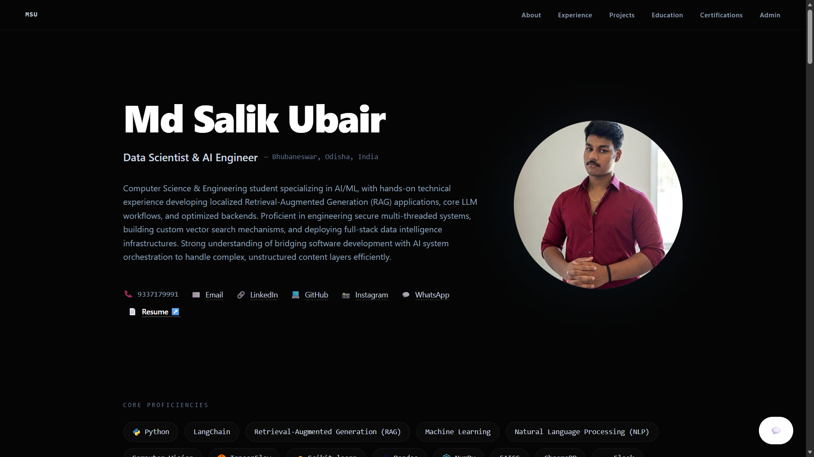
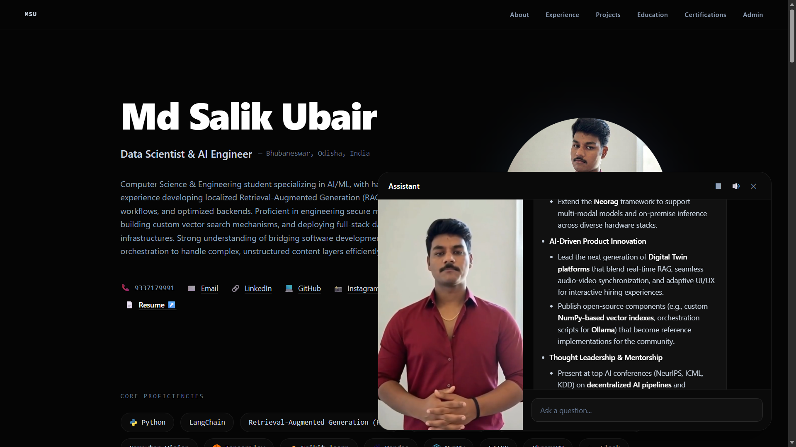
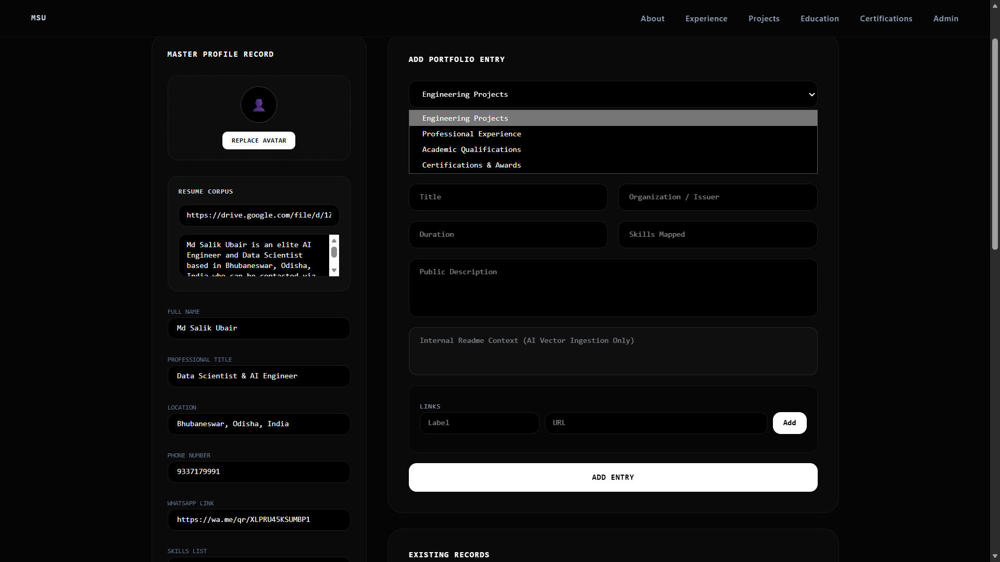
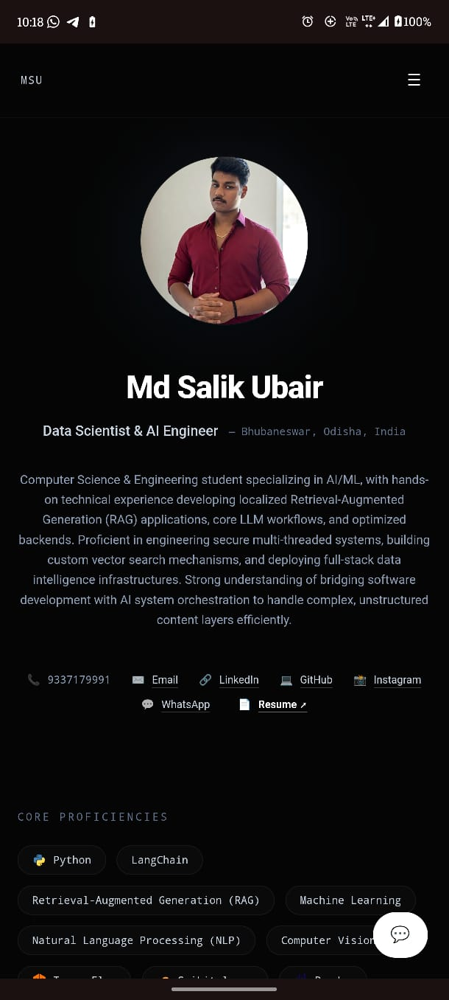

<div align="center">
  
</div>

<div align="center">

  <h1 align="center">MSU DIGITAL TWIN</h1>

  ### Production-Grade RAG Portfolio & Real-Time Context Engine

  [](https://react.dev/)
  [](https://tailwindcss.com/)
  [](https://flask.palletsprojects.com/)
  [](https://www.mongodb.com/atlas)
  [](https://www.trychroma.com/)
  [](https://groq.com/)
  [-4285F4?style=for-the-badge&logo=googlegemini&logoColor=white)](https://ai.google.dev/)
  [](https://portfolio-salik-live.vercel.app)
  [](LICENSE)

  <p align="center">
    <b>MSU Digital Twin</b> is a production-grade founder portfolio featuring an <b>interactive AI Digital Twin</b> powered by Retrieval-Augmented Generation (RAG), real-time audio-visual synchronization, and a <b>Dynamic Admin Matrix</b>. Heavy asynchronous AI inference and vector indexing are decoupled from the frontend client, delivering an ultra-minimalist executive UX.
  </p>

  <p align="center">
    <a href="https://portfolio-salik-live.vercel.app"><strong>✨ Experience Live App Now →</strong></a>
    &nbsp;•&nbsp;
    <a href="#-system-architecture--data-flow"><strong>🏗️ Architecture</strong></a>
    &nbsp;•&nbsp;
    <a href="#-local-deployment"><strong>⚙️ Run Locally</strong></a>
    &nbsp;•&nbsp;
    <a href="https://github.com/Md-Salik-Ubair"><strong>💻 GitHub</strong></a>
  </p>

</div>

---

## 📑 Table of Contents

- [Executive Summary](#-executive-summary)
- [Architectural Highlights](#-architectural-highlights)
  - [1. The Digital Twin RAG Engine](#1-the-digital-twin-rag-engine)
  - [2. Real-Time Audio-Visual Sync](#2-real-time-audio-visual-sync)
  - [3. Dynamic Admin Matrix](#3-dynamic-admin-matrix)
  - [4. Minimalist Executive UI](#4-minimalist-executive-ui)
- [System Architecture & Data Flow](#-system-architecture--data-flow)
- [Core Technology Stack](#-core-technology-stack)
- [Local Deployment](#-local-deployment)
- [Environment Variables](#-environment-variables)
- [Repository Structure](#-repository-structure)
- [Author](#-author)
- [License](#-license)

---

## 💡 Executive Summary

A static portfolio cannot answer a recruiter's follow-up question. The Digital Twin can: it retrieves from a vector index of the founder's real projects and CV, grounds the answer with verified facts, and replies in text **and** synthesized speech through a synchronized avatar.

| Problem with typical portfolios & chatbots | How MSU Digital Twin handles it |
| --- | --- |
| Static pages cannot answer follow-up questions | An interactive **AI Digital Twin** answers in real time using RAG over the portfolio's own data |
| LLMs invent personal facts | **Ground-truth injection**: dynamic age and verified project counts are inserted into the LLM context at runtime |
| One model rate-limit or outage kills the chat | **Multi-tier Groq engine**: `gpt-oss-120b` with automatic `20b` fallback |
| Text-only bots feel impersonal | **Edge-TTS** audio streaming synced to an avatar that switches between idle, thinking, and speaking states |
| Content edits require manual re-embedding | **Admin Hub** CRUD on MongoDB triggers a background worker that re-embeds and syncs ChromaDB — no downtime |
| Heavy AI work blocks the UI | Async inference and vector indexing are **decoupled** from the React client |
| Backend cold starts look like a broken site | A **monochromatic typography loader** masks backend wake-up cycles |
| Chat and avatar fight for mobile screen space | A fixed **40/60 mobile split** locks the avatar portrait while the chat log scrolls |

---

## 🧠 Architectural Highlights

### 1. The Digital Twin RAG Engine

<div align="center">
  
</div>

<br/>

| Layer | Implementation |
| --- | --- |
| **Inference Engine** | Multi-tier Groq LLM engine: `openai/gpt-oss-120b` with automatic fallback to `openai/gpt-oss-20b` for ultra-low-latency response synthesis |
| **Semantic Matrix** | `ChromaDB` vector store fed by Google Generative AI embeddings (`text-embedding-004`, 768-D); `RecursiveCharacterTextSplitter` provides crash-proof data ingestion |
| **Orchestration** | `LangChain` pipeline: query embedding → similarity search → context assembly → generation |
| **Hidden Context Embedding** | Deep technical documentation (`hidden_readme`) is embedded per database node, so the AI understands complex underlying architectures without cluttering the public UI |
| **Zero-Hallucination Guardrails** | Hardcoded ground-truth metrics (dynamic age, verified project counts) are injected directly into the LLM context at runtime |

### 2. Real-Time Audio-Visual Sync

- **Edge-TTS** streams synthesized speech in real time.
- A **hardware-accelerated video state controller** maps the avatar between three modes: **idle**, **thinking**, and **speaking**.
- The backend returns an **audio blob plus text payload**; the client plays the audio while the avatar state follows the response lifecycle.

### 3. Dynamic Admin Matrix

<div align="center">
  
</div>

<br/>

- **MongoDB Atlas integration** enables native CRUD operations on the master node schema.
- **Zero-downtime re-indexing:** updating a record automatically triggers a background worker thread that re-embeds the content and synchronizes ChromaDB.
- **Optimistic O(1) node reordering:** smooth `↑` / `↓` sequencing in the UI, synced to the persistent MongoDB schema.
- **Master Corpus Pipeline:** ingests raw master CV text directly into vector chunks for real-time memory expansion.

### 4. Minimalist Executive UI

<div align="center">
  
</div>

<br/>

<div align="center">
  
</div>

<br/>

- **Minimalist brand loading:** a monochromatic typography loader masks cold-start backend wake-up cycles.
- **Ghost Card layouts:** transparent card containers with ultra-subtle micro-borders keep visual hierarchy without boxed UI clutter (cyber-minimalist styling on Tailwind CSS v4).
- **Fixed mobile viewport split:** a precision-engineered **40/60** mobile modal layout keeps the avatar's portrait framing locked while the chat log scrolls.

---

## 🏗️ System Architecture & Data Flow

```text
[ Visitor / Technical Recruiter ]
        │
        ▼
[ React 18 + Tailwind Frontend Interface ]
        │
        ├───► [ Direct Inquiries ] ───► [ Official Channels: LinkedIn / Email ]
        │
        └───► [ AI Assistant Interactive Query ]
                    │
                    ▼
        [ Flask REST Backend Gateway ]
                    │
       ┌────────────┴───────────────────────────┐
       ▼                                        ▼
[ MongoDB Atlas Cloud ]               [ LangChain RAG Engine ]
 (Master Nodes Schema)                          │
       │                                        ├───► Gemini Text-Embedding-004 (768-D)
       │                                        ├───► ChromaDB Vector Similarity Search
       └────► [ Background Re-Index Worker ] ───┼───► Dynamic Ground-Truth Facts Injection
                                                │
                                                ▼
                                    [ Groq Multi-Tier Engine ]
                                  (gpt-oss-120b ➔ 20b Fallback)
                                                │
                                                ▼
                                    [ Edge-TTS Audio Engine ]
                                                │
                                                ▼
                                    [ Audio Blob + Text Payload ]
                                                │
                                                ▼
                                 [ Hardware-Accelerated Avatar Sync ]
```

### Query Lifecycle

| # | Stage | What happens |
| :-: | --- | --- |
| 1 | **Query intake** | The React client posts the visitor's question to the Flask REST gateway |
| 2 | **Embedding** | The query is embedded with Gemini `text-embedding-004` (768-D) |
| 3 | **Retrieval** | ChromaDB similarity search returns the most relevant portfolio nodes, including their hidden technical context |
| 4 | **Ground-truth injection** | Verified facts (dynamic age, verified project counts) are injected into the prompt context |
| 5 | **Generation** | Groq `gpt-oss-120b` synthesizes the answer; on failure the engine falls back to `gpt-oss-20b` |
| 6 | **Speech synthesis** | Edge-TTS converts the answer to audio |
| 7 | **Delivery & sync** | The client receives an audio blob plus text payload and drives the avatar through idle → thinking → speaking |

### Admin Re-Index Lifecycle

| # | Stage | What happens |
| :-: | --- | --- |
| 1 | **Edit** | An admin creates, updates, reorders, or deletes a node in the Admin Hub |
| 2 | **Persist** | The change is written to MongoDB Atlas |
| 3 | **Re-index** | A background worker thread re-embeds the affected content and synchronizes ChromaDB — the live site keeps serving queries |

---

## 🔬 Core Technology Stack

| Layer | Technologies | Purpose |
| --- | --- | --- |
| **Frontend** | React 18 (Vite), React-Markdown | Component UI, dynamic markdown rendering of AI responses |
| **Styling** | Tailwind CSS v4 | Grainy gradients, cyber-minimalist cards, ghost-card layouts |
| **Media** | Hardware-accelerated video elements | Avatar idle / thinking / speaking state controller |
| **API Gateway** | Python, Flask, Gunicorn (WSGI) | REST gateway and background worker threads |
| **Orchestration** | LangChain | RAG pipeline orchestration |
| **Vector Store** | ChromaDB | Vector similarity search |
| **Embeddings** | Google Generative AI `text-embedding-004` (768-D) | Semantic encoding of portfolio nodes and queries |
| **Persistence** | MongoDB Atlas | Master nodes schema, persistent storage, structural data |
| **Inference** | Groq API: `openai/gpt-oss-120b` → `openai/gpt-oss-20b` fallback | Ultra-low-latency multi-tier generation |
| **Speech** | Edge-TTS | Real-time audio streaming |
| **Hosting** | Vercel (frontend, live app) | Production delivery of the client |

---

## 🚀 Local Deployment

### Prerequisites

- **Node.js** 18+ (LTS recommended)
- **Python** 3.9+
- **MongoDB** instance (local, or a MongoDB Atlas cluster)
- API keys for **Google Gemini** and **Groq**

> Run the backend and frontend in **two separate terminals**, both starting from the repository root.

### 1. Backend

```bash
cd backend
python -m venv venv
```

Activate the virtual environment:

```bash
# Linux / macOS
source venv/bin/activate

# Windows (cmd / PowerShell)
venv\Scripts\activate
```

Install dependencies:

```bash
pip install -r requirements.txt
```

Create `backend/.env` (Windows users: create the file manually with the same contents):

```bash
cat > .env <<'EOF'
MONGO_URI=your_mongodb_connection_string
GEMINI_API_KEY=your_google_gemini_api_key
GROQ_API_KEY=your_groq_api_key
EOF
```

Run the server:

```bash
python run.py
```

The API is served at **http://127.0.0.1:5000**.

### 2. Frontend

In a second terminal, from the repository root:

```bash
cd frontend
npm install
```

Create `frontend/.env`:

```bash
cat > .env <<'EOF'
VITE_API_URL=http://127.0.0.1:5000
EOF
```

Start the development server:

```bash
npm run dev
```

Open the local URL printed by Vite (by default **http://localhost:5173**).

---

## 🔑 Environment Variables

**Backend** — `backend/.env`

| Variable | Description |
| --- | --- |
| `MONGO_URI` | MongoDB connection string (local instance or Atlas) |
| `GEMINI_API_KEY` | Google Gemini API key used for embeddings |
| `GROQ_API_KEY` | Groq API key used for LLM inference |

**Frontend** — `frontend/.env`

| Variable | Description |
| --- | --- |
| `VITE_API_URL` | Base URL of the Flask backend (`http://127.0.0.1:5000` locally) |

> 🔐 `.env` files contain secrets. Never commit them; keep them in `.gitignore`.

---

## 📁 Repository Structure

```text
.
├── backend/                  # Flask REST gateway, RAG engine, background re-index worker
│   ├── run.py                # Server entry point
│   ├── requirements.txt      # Python dependencies
│   └── .env                  # Backend secrets (not committed)
├── frontend/                 # React 18 + Vite + Tailwind CSS v4 client
│   └── .env                  # Frontend config (not committed)
├── ReadmeAssets/             # README screenshots
│   ├── 01_hero.png
│   ├── 02_loader.png
│   ├── 03_rag_twin.png
│   ├── 05_admin_hub.png
│   └── 06_mobile.png
└── README.md
```

---

## 👨‍💻 Author

<div align="center">

**Md Salik Ubair — Full-Stack AI Engineer**
B.Tech CSE (AI/ML) • 📍 Bhubaneswar, India

[](https://portfolio-salik-live.vercel.app)
[](https://github.com/Md-Salik-Ubair)
[](https://linkedin.com/in/md-salik-ubair)
[](mailto:mdsalikubair@gmail.com)

</div>

---

## 📄 License

Distributed under the **MIT License**. See [`LICENSE`](LICENSE) for details.

<div align="center">

⭐ **If this project helped or inspired you, consider starring the repo.** ⭐

</div>